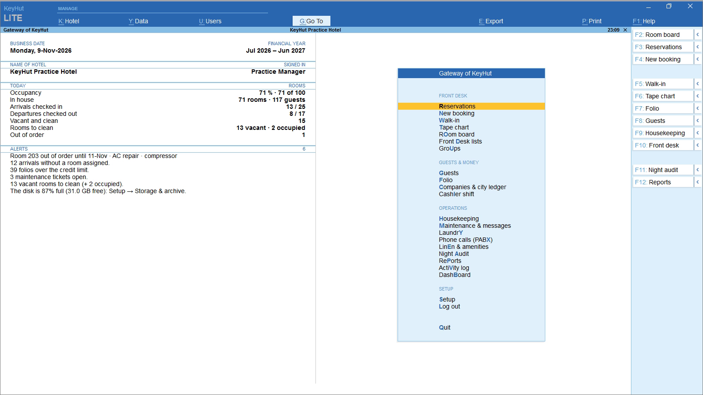
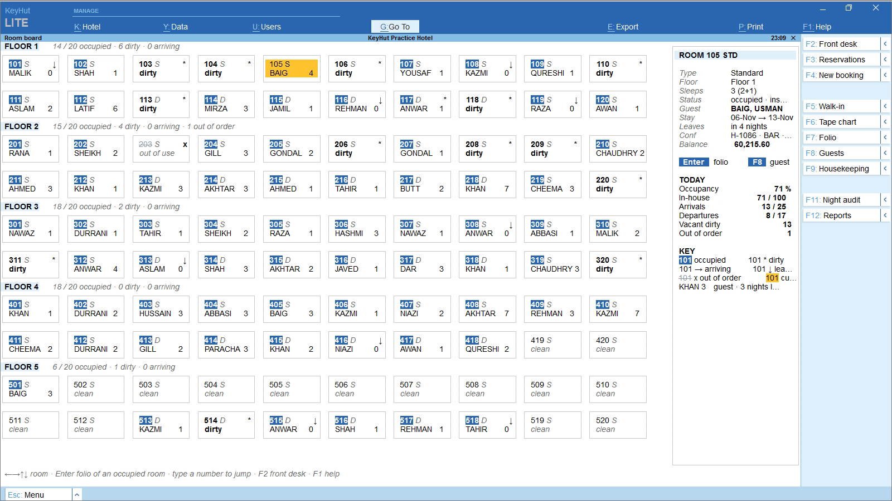
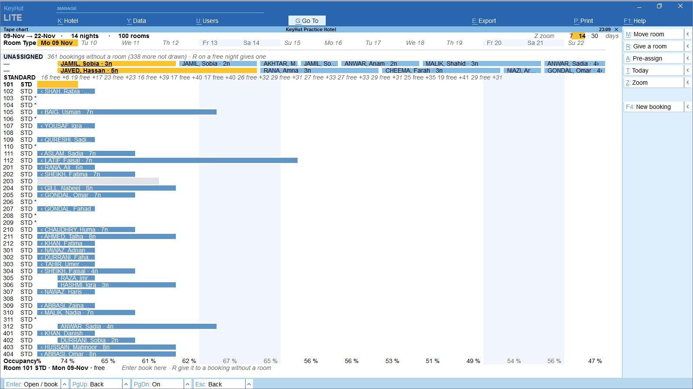
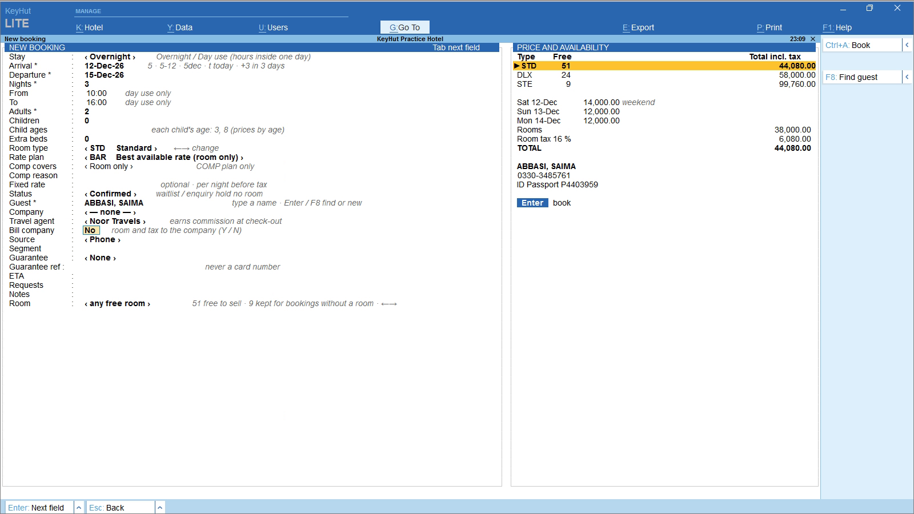
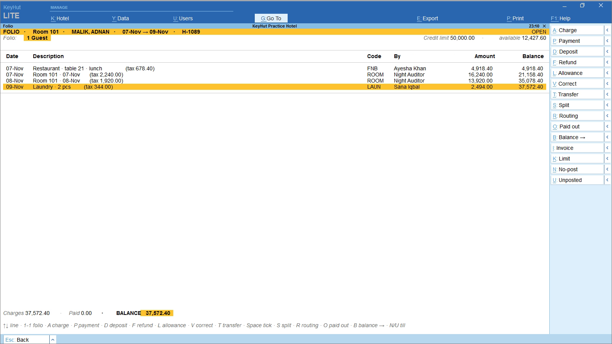
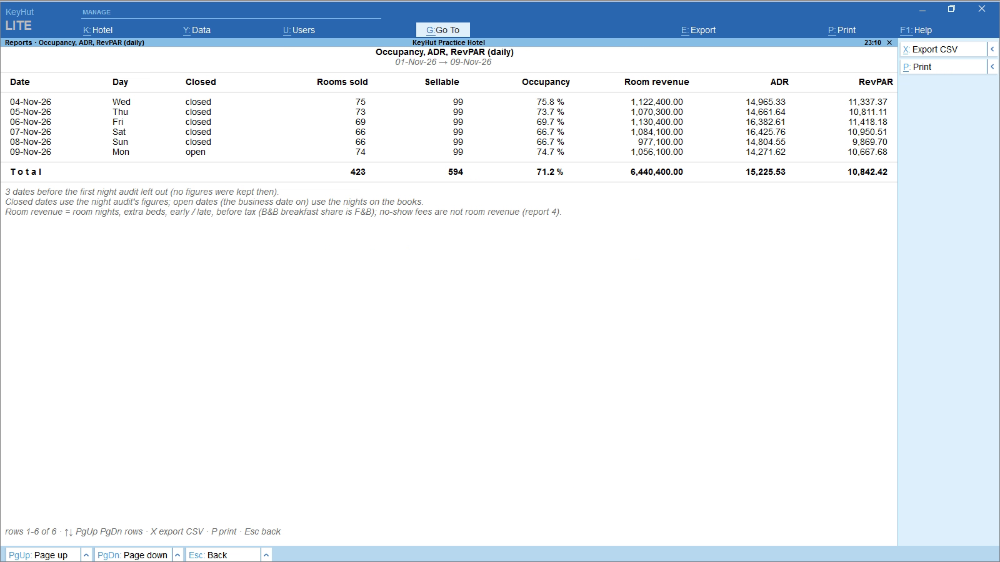

# KeyHut Hotel

**A free, offline hotel management system (PMS) for small hotels and guest houses. Run it entirely from the keyboard.**

KeyHut Hotel runs on one Windows PC, or several PCs sharing a SQL Server database. It needs no internet and has no
monthly fee. The screens follow TallyPrime: every screen is one key away, and you can type a few letters to jump anywhere.

**[Download the latest version](https://github.com/arsal381/keyhut-hotel/releases/latest)**

## What it does

- **Front desk**: room board, tape chart, reservations, walk-ins, groups, day use, pre-assigning rooms, room moves
- **Rates**: rate plans, weekend prices, child rates by age, extra beds, comp rooms, multiple taxes and currencies
- **Money**: guest folios, payments and deposits, split bills and routing to a company, city ledger, travel agent
  commission, cashier shifts with paid-outs
- **Operations**: housekeeping, maintenance tickets, laundry, linen and amenity stock, phone call charging (PABX)
- **Night audit** and **17 reports**: occupancy, ADR and RevPAR, revenue, room tax, cash-up, police guest register,
  city ledger aging and more, all exportable to CSV
- **Printing**: A4 invoices and 80 mm receipts, booking confirmations
- **Guests**: ID scans, signatures, a change history for every booking
- **Users**: sign-in with roles (manager, front desk...), activity log
- **Data**: SQLite for one PC or SQL Server for several, automatic backups, and a yearly archive so 10+ years of
  history stays fast

## Screens

| | |
|---|---|
|  |  |
| **F2 Room board**: status of every room | **F6 Tape chart**: who stays where, and when |
|  |  |
| **F4 New booking**: price and tax as you type | **F7 Folio**: the guest's bill |
|  | |
| **F12 Reports**: occupancy, ADR, RevPAR | |

## Install

1. Download `KeyHutHotel-Setup-<version>.exe` from [Releases](https://github.com/arsal381/keyhut-hotel/releases/latest).
2. Run it. Windows may say *"Windows protected your PC"* because the installer isn't signed by a known publisher
   yet: click **More info**, then **Run anyway**.
3. On first start, choose **Try it with practice data** to get a practice hotel full of made-up guests and bookings
   (kept in its own data file), or set up your own hotel.

**Needs:** Windows 10 or 11, .NET Framework 4.7.2 or later (already part of Windows 10 1803 and later).

Each download has a `.sha256` file next to it. The program's built-in update check (Setup → Updates) only installs a
setup whose SHA-256 matches it.

## Licence

KeyHut Hotel is freeware: free to use in any hotel, with no licence keys and no time limit. It comes with no warranty.
Keep your own backups.

## Feedback

Found a bug or missing something your front desk needs? [Open an issue](https://github.com/arsal381/keyhut-hotel/issues).
